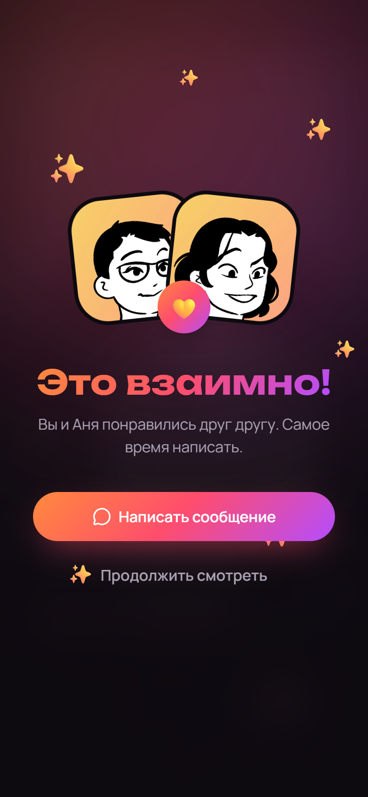
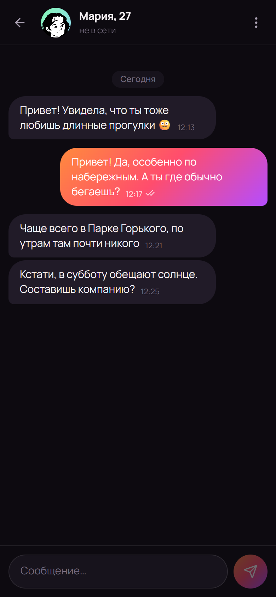
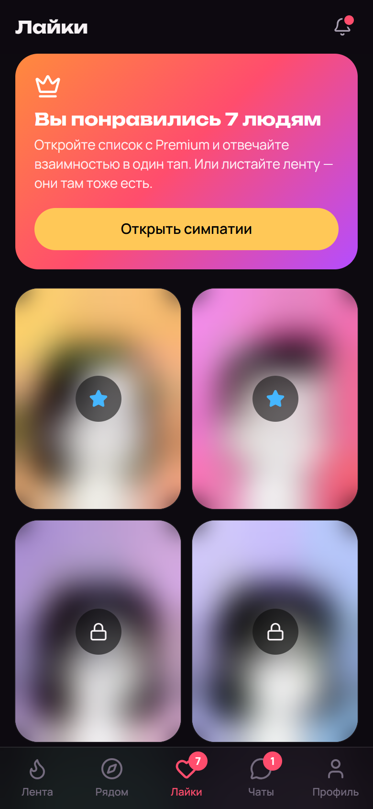
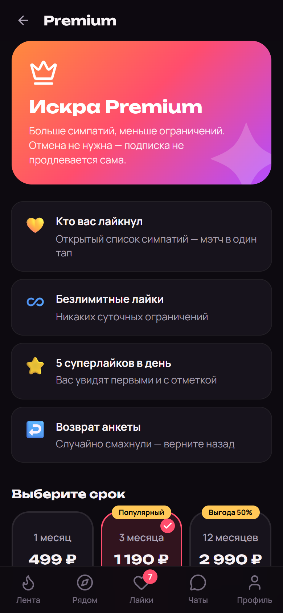
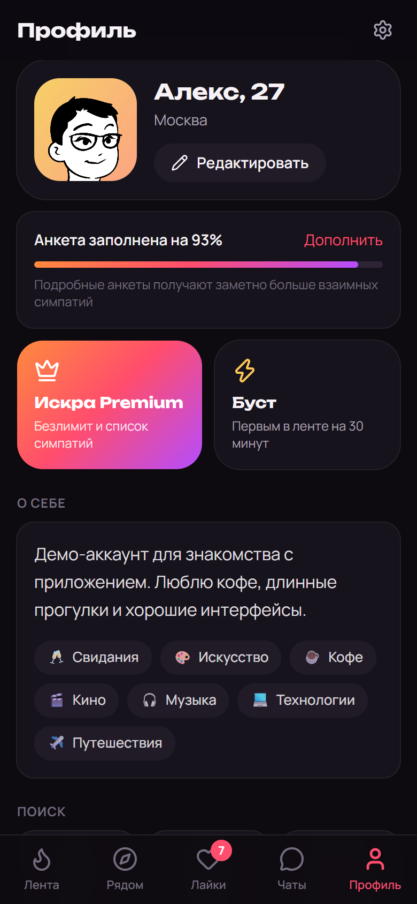
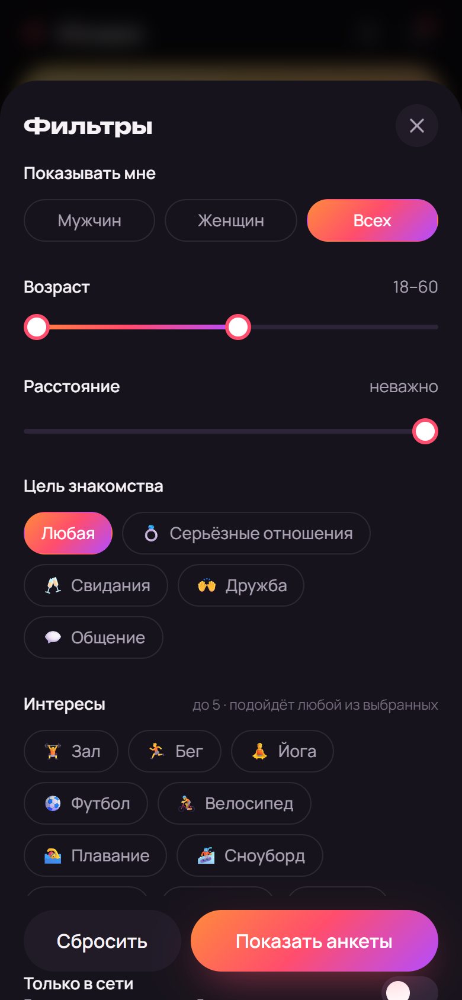
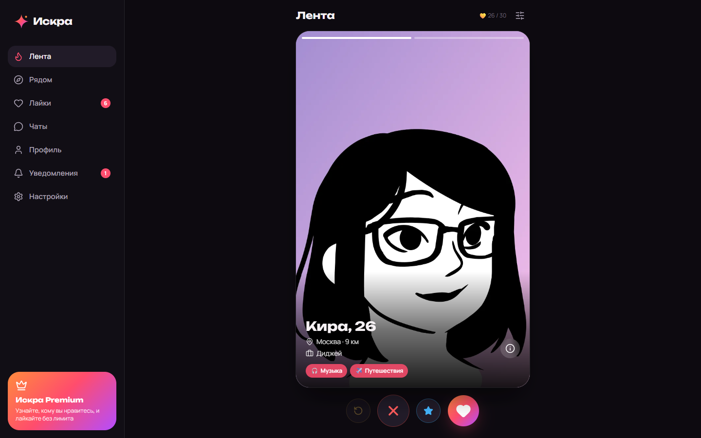
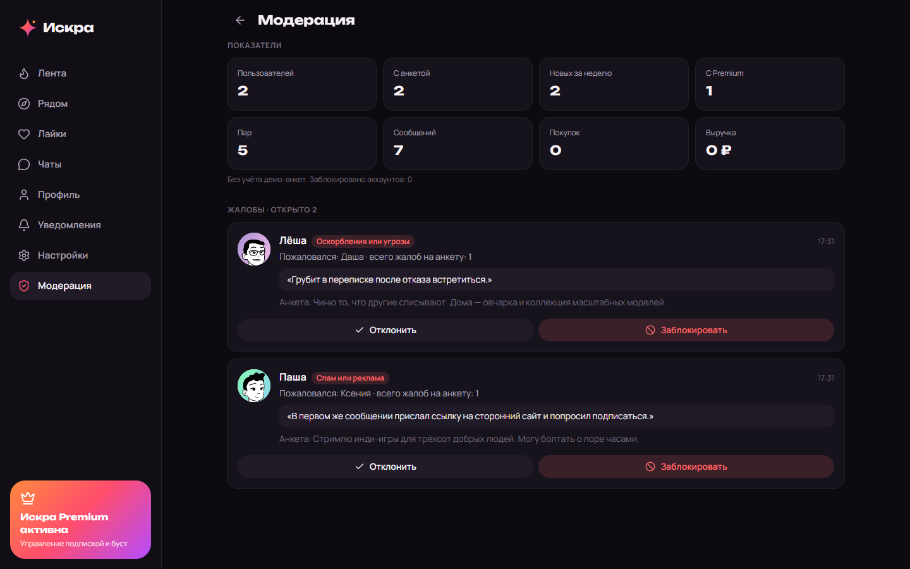

# Искра — знакомства рядом

Веб-приложение для знакомств: лента свайпов, люди рядом, взаимные симпатии и чат.
Подбор строится на одном правиле: вы выбираете, кого вам показывать — мужчин, женщин или всех, — и видите тех,
кому подходите сами. Писать можно только после взаимной симпатии.

Проектная работа OTUS: разработка полнофункционального веб-приложения с использованием AI-агентов. Только 18+.

## Демо

**https://iskra-xi.vercel.app** — приложение развёрнуто на Vercel (база Neon, фото в Vercel Blob).
Инструкция по деплою — [`docs/06-deploy.md`](docs/06-deploy.md).

Тестовые аккаунты (создаёт `npm run db:seed`):

| Роль | E-mail | Пароль |
| --- | --- | --- |
| Пользователь | `demo@iskra.app` | `demo1234` |
| Модератор, Premium | `admin@iskra.app` | `admin1234` |

На странице входа есть кнопка «Войти в демо-аккаунт».

## Скриншоты

| Лента | Взаимная симпатия | Чат | Рядом |
| --- | --- | --- | --- |
|  |  |  |  |

| Лайки без подписки | Premium | Профиль | Фильтры |
| --- | --- | --- | --- |
|  |  |  |  |

Десктоп:





Остальные экраны — в [`docs/screenshots`](docs/screenshots). Портреты в демо-данных — сгенерированные иллюстрации,
все персонажи вымышлены.

## Возможности

- **Регистрация и анкета.** Вход по e-mail, мастер из шести шагов, проверка возраста 18+.
- **Лента.** Свайпы жестом, кнопками и стрелками клавиатуры; суперлайк; возврат последней анкеты.
- **Рядом.** Сетка анкет по расстоянию с поиском по имени, профессии, городу и интересам.
- **Фильтры.** Возраст, расстояние, цель знакомства, интересы, «только в сети».
- **Взаимные симпатии и чат.** Отметки о прочтении, подсказки для первого сообщения.
- **Premium и буст.** Список «кто меня лайкнул», безлимитные лайки, покупка через кассу.
- **Безопасность.** Жалобы, блокировка, скрытие анкеты, удаление аккаунта; координаты не раскрываются.
- **Модерация.** Показатели сервиса и очередь жалоб для администратора.
- **Адаптивность.** Нижняя панель вкладок на телефоне, боковое меню на десктопе.

## Соответствие требованиям курса

| Требование | Где смотреть | Состояние |
| --- | --- | --- |
| Минимум 3 экрана | 19 страниц в `src/app` | ✅ |
| Адаптивный дизайн | Скриншоты `*-mobile` и `*-desktop` | ✅ |
| Формы и интерактив | Анкета, фильтры, чат, свайпы | ✅ |
| Состояния загрузки и ошибок | Скелетоны, `ErrorState`, `EmptyState` в `src/components/ui/misc.tsx` | ✅ |
| БД, минимум 3 связанные таблицы | 15 таблиц, `src/db/schema.ts` | ✅ |
| API с CRUD | 35 обработчиков, `src/app/api` | ✅ |
| Аутентификация | Сессии в базе, `src/lib/server/auth` | ✅ |
| Валидация | Общие схемы Zod, `src/lib/shared/validation.ts` | ✅ |
| Современный фреймворк | Next.js 16, React 19, TypeScript | ✅ |
| PostgreSQL | Drizzle ORM, миграции в `drizzle/` | ✅ |
| Git с понятной историей | `git log` | ✅ |
| README и документация процесса | Этот файл и `docs/` | ✅ |
| Деплой онлайн | [`docs/06-deploy.md`](docs/06-deploy.md) | ✅ https://iskra-xi.vercel.app |
| CI/CD | `.github/workflows/ci.yml`, автодеплой Vercel | ✅ деплой при каждом push; результаты CI — вкладка Actions |

Дополнительные функции (требуется минимум две):

| Функция | Состояние |
| --- | --- |
| Поиск и фильтрация данных | ✅ проверено тестами |
| Файловое хранилище (фото) | ✅ локальное хранилище проверено тестами; Vercel Blob — код без запуска |
| Интеграция с внешними API (геокодинг) | ✅ проверено вручную на живых сервисах |
| Платёжная система | ✅ тестовая касса проверена тестами; ЮKassa — код без запуска, нет ключей |
| Уведомления | ✅ лента уведомлений проверена тестами; web push — код без проверки доставки |
| OAuth2 (Google) | ⚠️ код написан, без ключей не запускался |
| Аналитика (Яндекс.Метрика) | ⚠️ подключается номером счётчика, без него не проверялась |

## Стек

| Слой | Технологии |
| --- | --- |
| Frontend | Next.js 16.4 (App Router), React 19, TypeScript, Tailwind CSS 4, SWR, Motion |
| Backend | Route Handlers Next.js, Drizzle ORM, Zod 4, sharp |
| База данных | PostgreSQL |
| Тесты | Vitest, Playwright |
| Инфраструктура | GitHub Actions, Vercel, Docker |

Почему так и какие были альтернативы — в [`docs/03-architecture.md`](docs/03-architecture.md).

## Запуск

Нужен только **Node.js 24** и Git. Docker и отдельная установка PostgreSQL не требуются: база поднимается
из npm-пакета.

```bash
git clone <адрес репозитория> iskra
cd iskra
npm install
cp .env.example .env.local     # в PowerShell: Copy-Item .env.example .env.local
npm run dev                    # база, миграции и сервер на http://localhost:3000
```

Во втором терминале — демо-данные (48 анкет и два тестовых аккаунта):

```bash
npm run db:seed
```

Чтобы демо-анкеты отвечали взаимностью и писали в чат, добавьте в `.env.local` строку `DEMO_MODE=true`.

> При первой установке npm 11 может не выполнить install-скрипты пакетов. Если `npm run dev` сообщает,
> что не найден PostgreSQL, выполните `npm rebuild esbuild @embedded-postgres/windows-x64`
> (на macOS и Linux — пакет своей платформы).

### Команды

| Команда | Что делает |
| --- | --- |
| `npm run dev` | Локальная база, миграции и сервер разработки |
| `npm run build` · `npm run start` | Production-сборка и её запуск |
| `npm run lint` · `npm run typecheck` | Линтер и проверка типов |
| `npm test` | Модульные тесты |
| `npm run test:e2e` | Сквозные тесты в браузере (нужны `db:seed` и `DEMO_MODE=true`) |
| `npm run db:generate` · `db:migrate` | Создать миграцию по схеме · применить миграции |
| `npm run db:seed` · `db:reset` | Демо-данные · пересоздать локальную базу |
| `npm run screenshots` | Переснять скриншоты для README |
| `npm run perf` | Замер скорости загрузки страниц |
| `npm run push:keys` | Сгенерировать ключи для push-уведомлений |

### Переменные окружения

Полный список с пояснениями — в [`.env.example`](.env.example). Обязательна только `DATABASE_URL`;
каждая необязательная интеграция включается своими ключами, а без них просто скрыта в интерфейсе.

## Тесты

```bash
npm test            # 46 модульных: валидация, возраст, расстояния, хэширование, защита путей
npm run test:e2e    # 36 сквозных: путь пользователя в браузере и правила доступа к API
```

Сквозные тесты проходят весь путь: регистрация → анкета с загрузкой фото → лайк → взаимная симпатия →
переписка → покупка Premium → фильтры → выход и вход. Отдельные наборы проверяют два настоящих аккаунта
(пара, чат, жалоба, блокировка, модерация, удаление) и то, что запрещённое в интерфейсе нельзя сделать прямым запросом.

## Структура

```
src/app          страницы и REST API
src/components   компоненты по областям
src/db           схема базы и подключение
src/lib/server   сессии, сервисы, хранилище — только сервер
src/lib/client   запросы к API и хуки — только браузер
src/lib/shared   схемы, типы, константы — общее
drizzle          SQL-миграции
scripts          база, сид, скриншоты, замеры
tests            unit и e2e
docs             документация
```

## Документация

| Документ | О чём |
| --- | --- |
| [`01-idea-and-competitors.md`](docs/01-idea-and-competitors.md) | Идея, аудитория, конкуренты, монетизация |
| [`02-user-stories-and-spec.md`](docs/02-user-stories-and-spec.md) | User Stories с критериями приёмки, ТЗ |
| [`03-architecture.md`](docs/03-architecture.md) | Архитектура, схема БД, API, принятые решения |
| [`04-ai-process.md`](docs/04-ai-process.md) | **Использование AI на этапах: промпт, проблемы, выводы** |
| [`05-security-audit.md`](docs/05-security-audit.md) | Аудит безопасности и известные ограничения |
| [`06-deploy.md`](docs/06-deploy.md) | Инструкция по деплою |
| [`07-defense.md`](docs/07-defense.md) | План презентации и сценарий демо |

## Что не сделано

- Нет подтверждения e-mail и восстановления пароля.
- ЮKassa, вход через Google и доставка push написаны по документации, но не запускались с настоящими ключами.
- Docker-образ и пайплайн CI не выполнялись: на машине разработки нет Docker, а CI стартует после первого push.
- Скорость загрузки ленты на медленном телефоне требует улучшения (LCP около 4 с) — замеры в `docs/04-ai-process.md`.

Проект учебный: юридические тексты, модерация фотографий и приём настоящих платежей для запуска на реальных
пользователях потребуют отдельной работы.
