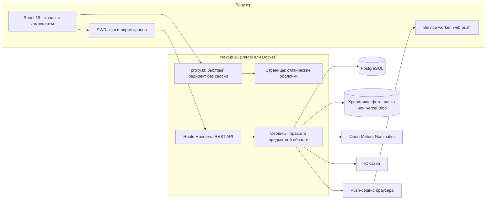
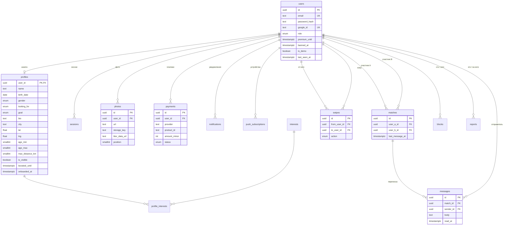

# Архитектура

## Обзор



**Ключевая идея.** Страницы — статические оболочки, которые отдаются мгновенно. Все данные интерфейс получает
из REST API через SWR. Так у проекта есть явный, документируемый API с CRUD, а страницы не зависят от запроса
и хорошо ложатся на модель Cache Components в Next.js 16.

## Стек и причины выбора

| Слой | Технология | Почему |
| --- | --- | --- |
| Фреймворк | Next.js 16.4 (App Router), React 19, TypeScript | Фронтенд и API в одном проекте, деплой на Vercel одной кнопкой |
| Стили | Tailwind CSS 4 | Дизайн-токены в одном файле, адаптив без отдельного CSS |
| Данные на клиенте | SWR | Кэш, повтор при ошибке, опрос для чата и счётчиков |
| Анимации | Motion | Жесты перетаскивания карточек |
| База | PostgreSQL + Drizzle ORM | Типобезопасные запросы, SQL-миграции в репозитории |
| Валидация | Zod 4 | Одна схема для формы и для сервера |
| Изображения | sharp | Сжатие в WebP, удаление метаданных, размытое превью |
| Тесты | Vitest, Playwright | Модульные и сквозные в настоящем браузере |

## Структура проекта

```
src/
  app/
    (auth)/            вход и регистрация
    (app)/             экраны после входа (общий каркас с навигацией)
    api/               REST API — по папке на ресурс
    onboarding/        мастер заполнения анкеты
    page.tsx           главная страница
  components/          компоненты по областям: discover, chat, profile, premium, ui…
  db/                  схема Drizzle и подключение
  lib/
    server/            код только для сервера: сессии, сервисы, хранилище
    client/            код только для браузера: запросы к API, хуки
    shared/            общее: схемы Zod, типы, константы, чистые функции
  proxy.ts             оптимистичная проверка cookie (бывший middleware)
drizzle/               SQL-миграции
scripts/               локальная база, миграции, сид, скриншоты
tests/                 unit и e2e
docs/                  документация
```

Правило зависимостей: `shared` не знает ни о сервере, ни о браузере; `server` и `client` друг друга не импортируют.
Обработчики API тонкие — разбирают запрос и вызывают сервис; правила предметной области живут в `lib/server/services`.

## База данных

15 таблиц, все связи — внешние ключи с каскадным удалением: удаление пользователя убирает его анкету, фото,
свайпы, пары и сообщения одной операцией.



Не показаны на схеме: `rate_limits` (счётчики ограничения частоты, без связей) и поля дат создания.

### Решения в схеме

| Решение | Зачем |
| --- | --- |
| Пара хранится упорядоченно (`user_a_id < user_b_id`) + уникальный индекс | Двое лайкнули одновременно — пара всё равно одна |
| Уникальный индекс `swipes (from, to)` | Повторный свайп ничего не ломает, запрос идемпотентен |
| `CHECK (birth_date <= current_date - 18 лет)` | Запрет на несовершеннолетних действует даже в обход приложения |
| Деньги в копейках (`amount_minor integer`) | Никаких ошибок округления дробных чисел |
| В `sessions` лежит хэш токена, а не сам токен | Утечка таблицы не позволяет войти в чужой аккаунт |
| `blur_data_url` у фото | Плейсхолдер при загрузке и безопасный тизер в «Лайках» |
| Счётчики rate limit в базе | У serverless-инстансов нет общей памяти |

### Правило подбора

Вся логика «кто кого видит» — одно условие в `lib/server/services/cards.ts`:

```
анкета.пол подходит под мой выбор «показывать мне»
  И мой пол подходит под выбор анкеты
```

Оно применяется в ленте, поиске, списке лайков и при самом свайпе, поэтому обойти его прямым запросом нельзя.
Расстояние считается в SQL по формуле гаверсинусов — расширения PostGIS не нужны, подойдёт любой PostgreSQL.

## API

Все ответы — JSON. Ошибка всегда имеет вид `{ "error": { "code", "message", "fields"? } }`.
Кроме `/api/auth/*`, `/api/config`, `/api/health` и вебхука, каждый запрос требует сессии.

| Метод и путь | Назначение |
| --- | --- |
| `POST /api/auth/register` · `login` · `logout` | Регистрация, вход, выход |
| `GET /api/auth/google` · `/callback` | OAuth2 через Google |
| `GET /api/me` · `PATCH` · `DELETE` | Мой профиль: чтение, изменение, удаление аккаунта |
| `POST /api/me/onboarding` | Первое заполнение анкеты |
| `POST /api/me/photos` · `PUT` · `DELETE /api/me/photos/:id` | Загрузка, порядок, удаление фото |
| `GET /api/me/counters` | Числа для бейджей |
| `GET /api/discover` | Лента для свайпов |
| `GET /api/nearby` | Сетка «Рядом»: поиск `q`, фильтры, пагинация `cursor` |
| `GET /api/users/:id` | Чужая анкета |
| `POST /api/swipes` · `DELETE` | Свайп; отмена последнего (Premium) |
| `GET /api/likes` | Кому я нравлюсь |
| `GET /api/matches` · `DELETE /api/matches/:id` | Пары; удалить пару |
| `GET /api/matches/:id/messages` · `POST` | Сообщения чата (`after`, `before`); отправка |
| `GET /api/blocks` · `POST` · `DELETE /api/blocks/:id` | Чёрный список |
| `POST /api/reports` | Жалоба |
| `GET /api/geo/search` · `/reverse` | Поиск города и определение по координатам |
| `GET /api/notifications` · `POST` | Лента уведомлений; отметить прочитанными |
| `POST /api/push/subscription` · `DELETE` | Подписка устройства на push |
| `POST /api/billing/checkout` | Создать платёж |
| `GET /api/billing/payments` · `/:id` · `POST` · `DELETE` | История; статус; подтверждение в тестовой кассе; отмена |
| `POST /api/billing/webhook/yookassa` | Уведомление платёжного сервиса |
| `GET /api/admin/stats` · `/reports` · `POST /reports/:id` | Модерация |
| `GET /api/files/*` | Раздача фото из локального хранилища |
| `GET /api/config` · `/api/health` | Включённые интеграции; проверка живости |

## Решения и компромиссы

| Вопрос | Решение | Цена |
| --- | --- | --- |
| Обновление чата | Опрос раз в 2,5 с через SWR | Задержка до 2,5 с и лишние запросы. Зато работает на serverless без отдельного сервера WebSocket |
| Своя аутентификация или библиотека | Своя: сессии в базе, scrypt из стандартной библиотеки | Нужно самим следить за безопасностью. Зато нет «магии» и лишних зависимостей, код объясним на защите |
| Локальная база | Пакет `embedded-postgres` — настоящий PostgreSQL через npm | Около 100 МБ в `node_modules`. Зато запуск одной командой без Docker |
| Хранилище фото | Интерфейс с двумя реализациями | Vercel Blob привязывает к платформе; замена — один файл |
| Демо-режим | Анкеты из сида отвечают взаимностью при `DEMO_MODE=true` | Искусственная активность. Только для показа, анкеты помечены как демонстрационные |
